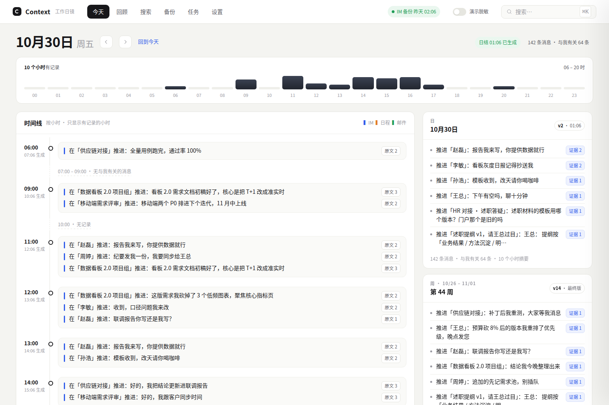
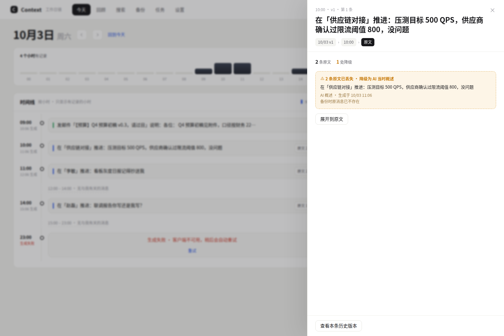
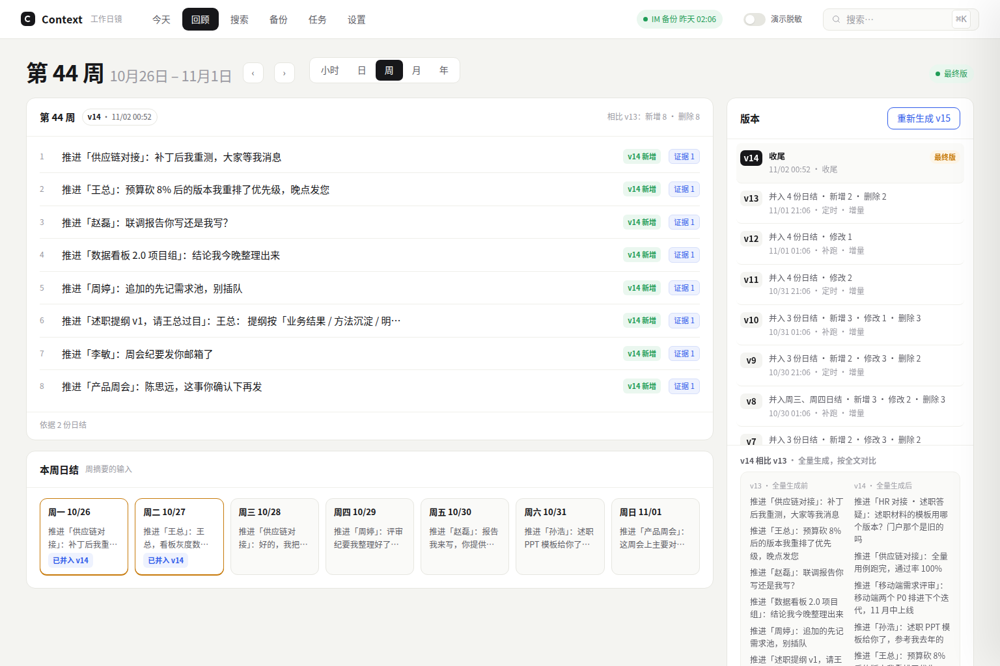
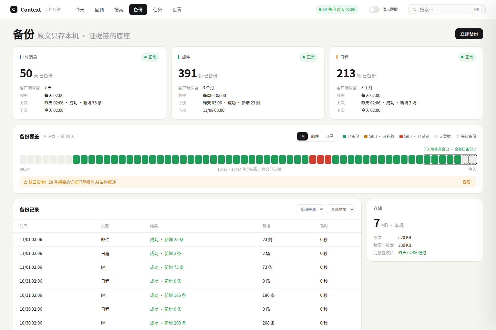
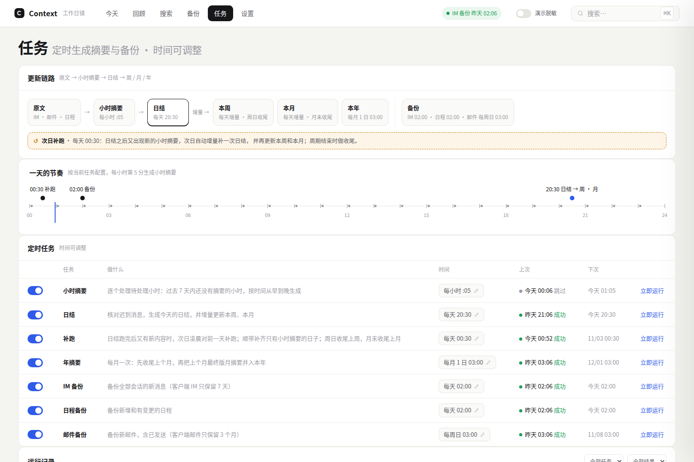

# Context · 工作日镜

本机运行的个人工作记录。它定时备份企业 IM 里的聊天、邮件和日程原文，按小时、日、周、月、年自动总结"我干了什么"。每一条总结都能沿证据链一层层点到当时的原话；原文过期丢了，就退回到 AI 当时写下的概述。



## 它解决什么

工作散在群聊、私聊、日程和邮件里，客户端的聊天记录只留 7 天、邮件只留 3 个月。到写周报、做复盘、被问"这事当时怎么定的"时，想不起来，也找不回原话。

Context 只做三件事：

- **存下来**：每天备份全部原文，永久保存在本机。
- **总结**：只总结"我参与的"会话（我说了话、@我、回复我、私聊、定向发给我），按小时 → 日 → 周 → 月 → 年逐层汇总，周、月、年增量更新。
- **可追溯**：任何一条总结都能点开证据链，直到原文；每个摘要保留全部版本，可以逐条对比。

数据只在本机：SQLite 单文件，服务只监听 `127.0.0.1`，只有调用模型时才把原文发给你配置的模型地址（设置页会如实显示数据去向）。

## 截图

| 证据链（原文丢失时降级） | 回顾：版本历史与对比 |
|---|---|
|  |  |
| **备份：覆盖与缺口** | **定时任务** |
|  |  |

截图里的人名、群名、聊天内容都是内置仿真客户端生成的假数据，摘要由不联网的演示模型拼出，所以读起来有点生硬。

## 快速体验

需要 Node.js ≥ 22.13（用内置的 `node:sqlite`，没有原生模块）。

```bash
git clone https://github.com/FFatTiger/context-workday.git
cd context-workday
npm install
npm run build

# 用仿真客户端快进 45 天，生成演示历史（约 10 秒）
node dist/cli.mjs sim --days 45 --data /tmp/ctx-demo
# 启动，打开 http://127.0.0.1:4318
node dist/cli.mjs start --demo --data /tmp/ctx-demo
```

想全局安装：`npm run pack:intranet` 产出 `context-workday-x.y.z.tgz`，再 `npm i -g ./context-workday-x.y.z.tgz`，之后直接用 `context-workday` 命令。

## 接入你自己的 IM

Context 不绑定任何 IM。它只认一个很薄的**数据源接口**（`src/source/types.ts`）：当前用户、通讯录、会话列表、某时间段的消息、日程、邮件。你写一个 `index.mjs` 把自己的客户端/SDK 映射过来即可，系统其余部分都不用动。

1. 复制模板 `examples/im-source/` 到 `~/.context-workday/source/`，填好里面的 TODO。
2. `context-workday doctor`：逐项检查返回的数据形状、时间单位、ID 唯一、会话关联，并统计五种参与形态的命中数，直到没有 ✗。
3. `~/.context-workday/config.json` 配好 OpenAI 兼容的模型接口：

   ```json
   {
     "source": "./source/index.mjs",
     "llm": { "baseUrl": "http://your-llm/v1", "model": "your-model" }
   }
   ```

   key 用环境变量 `CONTEXT_LLM_API_KEY` 传。
4. `context-workday start`。

逐字段说明、常见坑和验收清单见 [docs/intranet.md](docs/intranet.md)。

## 功能一览

- **今天**：当天不规则的小时时间线（没记录的小时折叠），右侧今天 / 本周至今 / 本月至今三张摘要卡。
- **证据抽屉**：条目 → 下层条目 → 原文，IM 原文可看前后上下文；原文丢失显示"降级为 AI 当时概述"和丢失原因。
- **回顾**：小时 / 日 / 周 / 月 / 年，版本历史、逐条差异、上游已变更提示和一键重建。
- **备份**：IM、邮件、日程各自的水位、逐日核对、覆盖条、可补救窗口告警、受缺口影响的摘要。
- **任务**：7 个定时任务（小时摘要、日结、补跑、年摘要、三个备份），时间可调；电脑睡眠或程序关闭后自动补跑。
- **搜索**：摘要和已备份原文的关键词搜索，按时间、来源筛选，点击直达对应位置。
- **设置**：参与口径开关、模型连接测试、演示脱敏（人名、群名、金额、邮箱一键替换，方便给别人演示）。

## 开发

```bash
npm install
npm run dev          # 后端 --demo（4318）+ 前端 vite（5173）
npm run typecheck
npm test             # vitest
npm run build
```

- 技术栈：TypeScript、Node `node:sqlite`、Hono、React + Vite。服务端用 esbuild 打成单文件，运行时零依赖。
- 代码结构和模块归属：[AGENTS.md](AGENTS.md)；术语：[CONTEXT.md](CONTEXT.md)；决策记录：[docs/adr/](docs/adr/)。
- 功能规格：[.scratch/context-v1/spec.md](.scratch/context-v1/spec.md)；界面规范和可点击原型：[docs/design/](docs/design/)。
- `.scratch/context-v1/issues/` 是开发过程中的实现票，每张票末尾有实现报告。

## License

[MIT](LICENSE)
